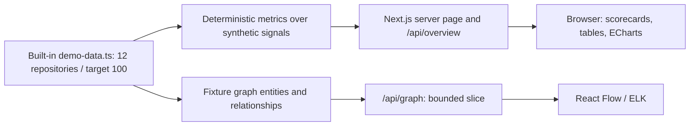
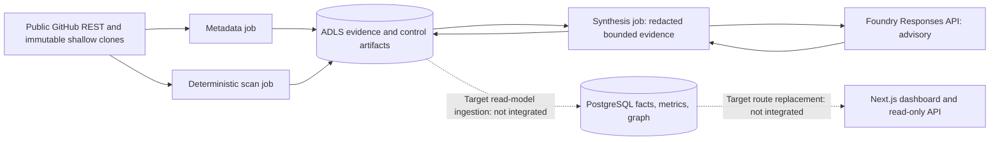

# Architecture

## Actual dashboard path

The server page and API routes import `apps/web/src/lib/demo-data.ts`. The
fixture includes public repository names and metadata plus synthetic scores,
groupings, recommendations, and graph relationships. It is not a live
assessment. The dashboard does not read PostgreSQL, trigger collection, or call
Foundry. Development needs no environment configuration or backing services.

`docs/demo/synthetic-sample.json` is a **separate offline workshop artifact** for
anonymized reuse. It is not loaded by the dashboard and does not add a data-mode
switch. The evidence example and opportunity brief illustrate a handoff, not a
measured customer outcome.

## Target Azure integration — not end-to-end verified

Collector, scanner, synthesis, evidence-store, database, contracts, metrics, and
graph components exist in source. The collector can write a local manifest/scan
plan and evidence/control artifacts; the scanner consumes a plan and emits scan
artifacts; synthesis consumes evidence and writes dossiers. PostgreSQL schema
and bootstrap tooling exist separately. Do not imply jobs populate dashboard
read models today. Deployment, live RBAC, identity, capacity, and full
collection-to-dashboard integration remain verification gates.

## Principles and trust boundaries

1. Public GitHub repositories are external, read-only sources; no writes or
   source-organization installation.
2. Cloned code and documentation are untrusted data, never instructions or
   executable build/test inputs. The scanner disables hooks, LFS smudging,
   prompts, and submodules.
3. Deterministic evidence is separated from model judgment. Target results retain
   commit, evidence ID/checksum, tool/model, schema, and dataset lineage.
4. Synthesis uses bounded, redacted evidence without shell, browser, or GitHub
   write tools; advisory claims need resolvable evidence.
5. Azure components are designed for managed identities. Local development
   password/storage-key overrides are ignored in production.
6. Open evidence formats and replaceable adapters avoid binding conclusions to
   a model or visualization.

Immutable evidence paths must not be replaced. Mutable `current/*` control
pointers also exist; operators must inspect failure summaries before treating a
dataset as complete. Scheduling alone does not enforce downstream completion.

## Access modes

`PUBLIC_DASHBOARD=true` returns an anonymous viewer **before** any other auth
check. Otherwise development can use its default bypass unless
`DEV_AUTH_DISABLED=false`. To test the local gate set both flags to `false`.
Production requires `EASY_AUTH_ENABLED=true` for non-public access, trusted
platform principal headers, and validated tenant/issuer/audience/expiry claims.
Do not trust a client-supplied principal header on an unprotected ingress.

Infrastructure external ingress is enabled when `configureEntraAuth` **or**
`publicDashboard` is true. Thus Entra mode is externally reachable but
authenticated, not network-private. Both false gives internal ingress and a
production application gate that denies unauthenticated data access.
See [deployment mode verification](../operations/production-deployment.md).

## Estate graph and interpretation

Contracts support organization, ministry, portfolio, project, repository,
capability, technology, integration, proposed shared-module, and Agentic Workflow
nodes. Inferred ministry assignments are candidate-only; inferred edges carry
confidence and evidence references. Fixture references are illustrative, not
collected proof.

The graph API accepts a focus, depth 0–4, and limit 1–500. The browser uses graph
slices and ELK layout; no full-estate scalability or production performance is
claimed. Health, confidence, and coverage are separate: unknown evidence is not
a failed check. See [methodology](../methodology/evidence-and-scoring.md).

## Future partnership path

A separately authorized, partner-approved GitHub App/webhook integration could
improve freshness, with reconciliation as a correctness backstop. Source writes,
private customer repositories, and write-capable Agentic Workflows require new
authorization, security review, and operational ownership; they are out of scope
for this read-only accelerator.
